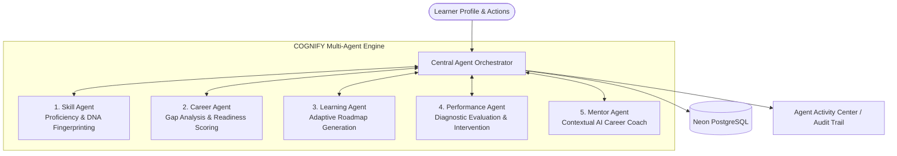

# COGNIFY AI
### Transform Knowledge into Career Intelligence.

[](https://fastapi.tiangolo.com)
[](https://react.dev)
[](https://neon.tech)
[](https://tailwindcss.com)
[](#multi-agent-ai-architecture)

> **Competitive Hackathon Project**: An intelligent, adaptive career development and personalized learning platform powered by genuine collaborative Agentic AI, Neon PostgreSQL, and real-time skill gap intelligence.

---

## 🌟 Executive Overview & Product Vision

Traditional learning platforms recommend generic video playlists based on loose tags. **COGNIFY AI** fundamentally changes this paradigm: it continuously evaluates, predicts, recommends, and adapts based on live diagnostic performance.

COGNIFY AI continuously answers seven critical questions:
1. **What skills does the learner currently possess?** (Claimed vs Assessed vs Demonstrated)
2. **How proficient is the learner?** (Weighted proficiency & confidence scoring)
3. **What skills are missing for the target career?** (Dynamic gap analysis)
4. **What should the learner learn next?** (Personalized dependency-aware roadmap)
5. **Is the learner improving?** (Performance diagnostics & velocity tracking)
6. **How should the roadmap adapt?** (Autonomous remediation & intervention)
7. **How close is the learner to career readiness?** (Mathematical readiness metric)

---

## 🤖 5-Agent Collaborative AI Architecture

COGNIFY AI implements five genuinely independent, specialized AI agent modules coordinated through a central Python orchestrator.



### 1. COGNIFY Skill Agent (`app.agents.skill_agent`)
- Distinguishes between **claimed**, **assessed**, and **demonstrated** competencies.
- Computes skill confidence, strengths, and weaknesses across technical and cognitive domains.
- Generates 6-dimensional **Skill DNA** (Programming, Architecture, Problem Solving, DevOps, Systems, Communication).

### 2. COGNIFY Career Agent (`app.agents.career_agent`)
- Computes weighted career readiness:
  $$\text{Career Readiness} = \frac{\sum (\text{Current Proficiency} \times \text{Skill Importance})}{\sum \text{Skill Importance}}$$
- Identifies critical vs moderate skill gaps for 9+ pre-loaded career pathways.
- Explains the architectural necessity of every missing competency.

### 3. COGNIFY Learning Agent (`app.agents.learning_agent`)
- Synthesizes personalized roadmaps with dependency sequencing and milestone projects.
- Adapts weekly tasks when performance shifts or goals change.
- Injects practical exercises, duration estimates, and completion criteria.

### 4. COGNIFY Performance Agent (`app.agents.performance_agent`)
- Diagnoses assessment submissions and identifies conceptual failure points.
- Automatically triggers remedial learning sequences upon poor performance (e.g., <50% score).
- Adapts learner proficiency levels and signals the Orchestrator to revise roadmaps.

### 5. COGNIFY Mentor Agent (`app.agents.mentor_agent`)
- Context-aware career guide with access to the learner's actual profile, readiness score, and gaps.
- Provides targeted technical explanations, mock interview drills, and strategic career coaching.

---

## 🚀 Key Signature Innovation Features

1. **Career Readiness Intelligence**: Real-time calculated readiness with strong/missing competency breakdowns.
2. **Career What-If Simulator**: Side-by-side comparative readiness analysis across 3+ career trajectories with transferable skill mapping.
3. **Adaptive Learning Remediation Engine**: Autonomous intervention injecting remedial tasks when weakness patterns are detected.
4. **Skill DNA Radar Visualization**: Dynamic 6-axis polygonal skill fingerprint powered by Recharts.
5. **Project-Based Skill Verification**: Evidence-based GitHub project inspection analyzing claimed vs demonstrated skills.
6. **Agent Activity Center**: Live audit trail logging agent name, input, output, execution status, and processing duration in milliseconds.

---

## 🛠️ Technology Stack

| Layer | Technologies |
|---|---|
| **Frontend** | React 19, Vite, TypeScript, Tailwind CSS, Lucide React, Recharts, Framer Motion |
| **Backend** | Python 3.11+, FastAPI, Pydantic v2, SQLAlchemy 2.0 (Async), Alembic |
| **Database** | Neon PostgreSQL (Serverless, Direct Connection Pooling & TLS) |
| **AI / LLM** | Grok API / Google Gemini API + Deterministic Expert Rule Fallbacks |
| **Security** | JWT Bearer Tokens, Bcrypt Password Hashing, CORS middleware |

---

## 📦 Project Structure

```
PromtWars X RTC/
├── backend/
│   ├── alembic/              # Database migration scripts
│   ├── app/
│   │   ├── agents/           # 5 Independent AI Agents & Orchestrator
│   │   │   ├── base_agent.py
│   │   │   ├── skill_agent.py
│   │   │   ├── career_agent.py
│   │   │   ├── learning_agent.py
│   │   │   ├── performance_agent.py
│   │   │   ├── mentor_agent.py
│   │   │   ├── orchestrator.py
│   │   │   └── grok_client.py
│   │   ├── api/routes/       # FastAPI REST endpoints
│   │   ├── core/             # Config, security, async database session
│   │   ├── models/           # 16 SQLAlchemy 2.0 DB models
│   │   ├── schemas/          # Pydantic validation schemas
│   │   └── services/         # Business logic & intelligence engines
│   ├── fast_seed.py          # Optimized database seeder for Neon
│   ├── requirements.txt      # Python dependencies
│   └── main.py               # FastAPI entrypoint
├── frontend/
│   ├── src/
│   │   ├── components/       # UI layout, Sidebar, shared widgets
│   │   ├── context/          # Auth context & state management
│   │   ├── pages/            # 16 complete application pages
│   │   ├── services/         # Axios / Fetch API client
│   │   └── App.tsx           # React Router configuration
│   ├── package.json
│   ├── tailwind.config.js
│   └── vite.config.ts
└── README.md
```

---

## ⚡ Quickstart & Setup Guide

### Prerequisites
- Python 3.11+
- Node.js 18+ & npm
- Neon PostgreSQL database instance

### 1. Backend Setup
```bash
cd backend
python -m venv venv
.\venv\Scripts\activate      # On Windows
# source venv/bin/activate   # On Linux/macOS

pip install -r requirements.txt
```

Create `backend/.env`:
```env
DATABASE_URL=postgresql://neondb_owner:<password>@<neon-host>/neondb?sslmode=require
SECRET_KEY=cognify-ai-super-secret-key-2026-hackathon
ACCESS_TOKEN_EXPIRE_MINUTES=1440
GEMINI_API_KEY=<your-gemini-key>
GROK_API_KEY=<your-grok-key>
```

Seed the database and start the server:
```bash
python fast_seed.py
python -m uvicorn app.main:app --host 127.0.0.1 --port 8000 --reload
```
API Documentation: `http://127.0.0.1:8000/docs`

### 2. Frontend Setup
```bash
cd frontend
npm install
npm run dev
```
Open `http://localhost:5173` in your browser.

---

## 🎭 Hackathon Demo Walkthrough (Alex Morgan Scenario)

1. **Sign In**:
   - Email: `alex@cognify.ai`
   - Password: `password123`
2. **Intelligence Dashboard**:
   - Inspect Alex's preloaded target role: **Full Stack Developer**.
   - Review initial **Career Readiness Score (~37%)**.
   - Check **Skill DNA Radar** showing Python (80%) and SQL (75%) strengths with JavaScript (0%) and React (0%) critical gaps.
3. **Skill Gap Analysis**:
   - View weighted gaps, required vs current proficiency, and agent reasoning.
4. **Adaptive Learning Roadmap**:
   - Observe the 6-week personalized roadmap synthesized by the Learning Agent.
5. **Assessment Center & Autonomous Remediation**:
   - Select the **JavaScript Core Assessment**.
   - Submit answers scoring 25% (or take the assessment).
   - Watch the **Performance Agent** diagnose the failure, update JS proficiency, and trigger the **Learning Agent** to autonomously inject remedial practice modules into the roadmap!
6. **Career What-If Simulator**:
   - Compare **Full Stack Developer** vs **Data Scientist** vs **AI Engineer**.
   - Switch target career to **Data Scientist**: see readiness jump to **~65%** because Python and SQL transfer seamlessly while completed competencies are preserved.
7. **Agent Activity Center**:
   - Audit real-time agent execution logs with timestamps and millisecond durations.

---

## 📄 License
MIT License. Built with ❤️ for the PromptWars / Cognify AI Hackathon.
